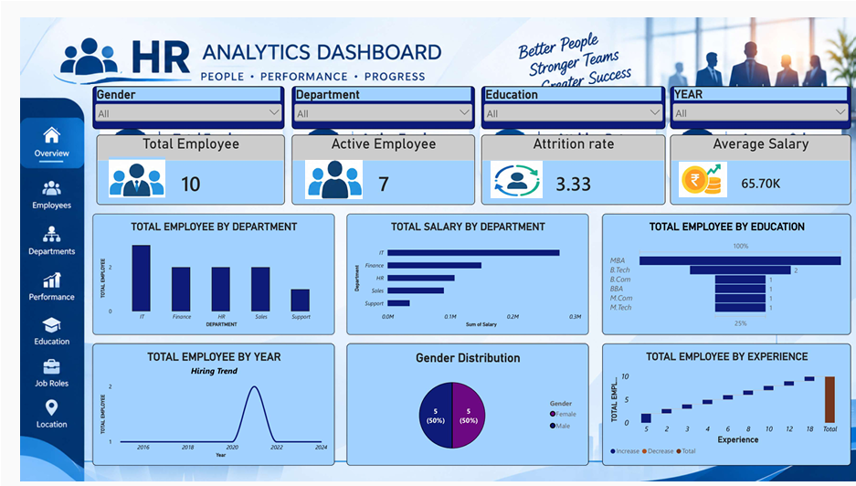

# HR Analysis Dashboard

## 📌 Project Overview

The HR Analysis Dashboard is an interactive Business Intelligence project developed using **Microsoft Power BI**. It focuses on analyzing employee data to understand workforce distribution, employee demographics, attrition patterns, and HR trends.

## 🛠️ Tools & Technologies

- Microsoft Power BI
- Power Query
- DAX (Data Analysis Expressions)
- Data Cleaning and Transformation
- Data Visualization

## 📊 Key Analysis Areas

- Employee Headcount
- Workforce Demographics
- Employee Attrition
- Department-wise Analysis
- HR Performance Indicators

## 🎯 Project Objective

- Analyze employee data to identify workforce patterns.
- Understand employee distribution across departments.
- Explore employee demographics and attrition trends.
- Present HR information through interactive visualizations.
- Support data-driven workforce analysis.

## 🖼️ Dashboard Preview

## 💡 Skills Demonstrated

- Data Analysis
- Data Cleaning and Transformation
- Power BI Dashboard Development
- Business Intelligence
- Data Visualization

## 👩‍💻 Author

**Akanksha Pawar**

[GitHub](https://github.com/AKANKSHASUBHASHPAWAR)

